# 03 — Route Map

This document outlines the routing structure for the Lao Bao Digital Ecosystem, detailing the URL paths, their descriptions, and sidebar groupings.

---

## 1. Global Route Architecture

### Public Routes
*   `/` - Landing page (general overview, pillars, public roadmap)
*   `/login` - Mock authentication login page
*   `/forgot-password` - Mock password recovery page

---

## 2. Dashboard Shell (`/dashboard`)
All management and monitoring screens reside under the authenticated `/dashboard` prefix.

### Group 1: General & Operations (Tổng quan & Điều hành)
*   `/dashboard` - General overview and key leadership indicators
*   `/dashboard/indicators` - Catalog of 62 socio-economic and daily operational indicators
*   `/dashboard/reports` - Analytical report generation (Excel, PDF, Word export)
*   `/dashboard/notifications` - User alerts and notifications inbox

### Group 2: Digital Data Repository (Kho dữ liệu số - 9 Lĩnh vực)
*   `/dashboard/administrative-population` - Administrative boundaries and population metrics
*   `/dashboard/economy` - Corporate entities, OCOP, public investments, and local budget
*   `/dashboard/tourism-services` - Historic monuments, lodging, tourism points, and media assets
*   `/dashboard/land-planning` - Land use, urban developments, and technical infrastructure
*   `/dashboard/agriculture-environment` - Crops, livestock, forestry, waste management, and water systems
*   `/dashboard/education-health` - Schools, education metrics, medical facilities, and health statistics
*   `/dashboard/social-welfare` - Beneficiary statistics, poverty indexes, and support programs
*   `/dashboard/security-defense` - National security targets, militia statistics, fire safety, and incident tracking (Confidential)
*   `/dashboard/disaster-emergency` - Landslide/flood hazards, "4-on-site" resources, and emergency event triggers

### Group 3: Data Workflows (Quy trình dữ liệu)
*   `/dashboard/data-templates` - Managed collection forms and Excel templates
*   `/dashboard/data-imports` - Batch CSV/Excel data import center with validation
*   `/dashboard/data-approvals` - Data validation and approval inbox (Unit & Governance approvals)
*   `/dashboard/data-publication` - Public release console for normalized datasets
*   `/dashboard/data-versions` - Data version control and historic rollback center
*   `/dashboard/data-search` - Global cross-module data catalog query (with text/AI search placeholder)

### Group 4: Smart Map (Bản đồ số)
*   `/dashboard/map` - Main interactive GIS map workspace
*   `/dashboard/map/layers` - GIS layer management (ordering, styling, visibility permissions)
*   `/dashboard/map/features` - Spatial features editor (points, lines, polygons linked to records)

### Group 5: System Administration (Quản trị hệ thống)
*   `/dashboard/users` - User account administration and permission assignment
*   `/dashboard/roles` - Role definitions and access policies
*   `/dashboard/organizations` - Organizational hierarchy and unit units editor
*   `/dashboard/staff` - Civil servant directory and operational status
*   `/dashboard/audit-logs` - System audit log (including special QP-AN security audit stream)
*   `/dashboard/backups` - Periodic backup schedules, retention settings, and soft-delete recovery
*   `/dashboard/integrations` - Configuration settings for external connectors (province databases, public service gates)
*   `/dashboard/settings` - General system variables and update frequencies per dataset

### Guard Utility Routes
*   `/dashboard/access-denied` - Fallback page when user permissions restrict access to a route

---

## 3. Sidebar Organization (Menu Groupings)
The desktop and mobile navigation shells collapse routes into 5 clean accordion menus rather than flat listings:

```mermaid
graph TD
    DashboardShell["/dashboard App Shell"] --> G1["1. Tổng quan & điều hành"]
    DashboardShell --> G2["2. Kho dữ liệu số"]
    DashboardShell --> G3["3. Quy trình dữ liệu"]
    DashboardShell --> G4["4. Bản đồ số"]
    DashboardShell --> G5["5. Quản trị hệ thống"]

    G1 --> D1["Tổng quan (/dashboard)"]
    G1 --> D2["Bộ chỉ số (/dashboard/indicators)"]
    G1 --> D3["Báo cáo (/dashboard/reports)"]
    
    G2 --> DS1["Hành chính & Dân cư"]
    G2 --> DS2["Kinh tế"]
    G2 --> DS3["Du lịch & Dịch vụ"]
    G2 --> DS4["Đất đai & Quy hoạch"]
    G2 --> DS5["Nông nghiệp & Môi trường"]
    G2 --> DS6["Giáo dục & Y tế"]
    G2 --> DS7["An sinh xã hội"]
    G2 --> DS8["Quốc phòng - An ninh"]
    G2 --> DS9["Thiên tai & Khẩn cấp"]

    G3 --> W1["Biểu mẫu (/dashboard/data-templates)"]
    G3 --> W2["Nhập/Import (/dashboard/data-imports)"]
    G3 --> W3["Phê duyệt (/dashboard/data-approvals)"]
    G3 --> W4["Công bố (/dashboard/data-publication)"]
    G3 --> W5["Phiên bản (/dashboard/data-versions)"]
    G3 --> W6["Tra cứu (/dashboard/data-search)"]

    G4 --> M1["Bản đồ (/dashboard/map)"]
    G4 --> M2["Lớp bản đồ (/dashboard/map/layers)"]
    G4 --> M3["Đối tượng (/dashboard/map/features)"]

    G5 --> A1["Người dùng (/dashboard/users)"]
    G5 --> A2["Vai trò (/dashboard/roles)"]
    G5 --> A3["Đơn vị (/dashboard/organizations)"]
    G5 --> A4["Cán bộ (/dashboard/staff)"]
    G5 --> A5["Audit logs (/dashboard/audit-logs)"]
    G5 --> A6["Sao lưu (/dashboard/backups)"]
    G5 --> A7["Tích hợp (/dashboard/integrations)"]
    G5 --> A8["Cấu hình (/dashboard/settings)"]
```

